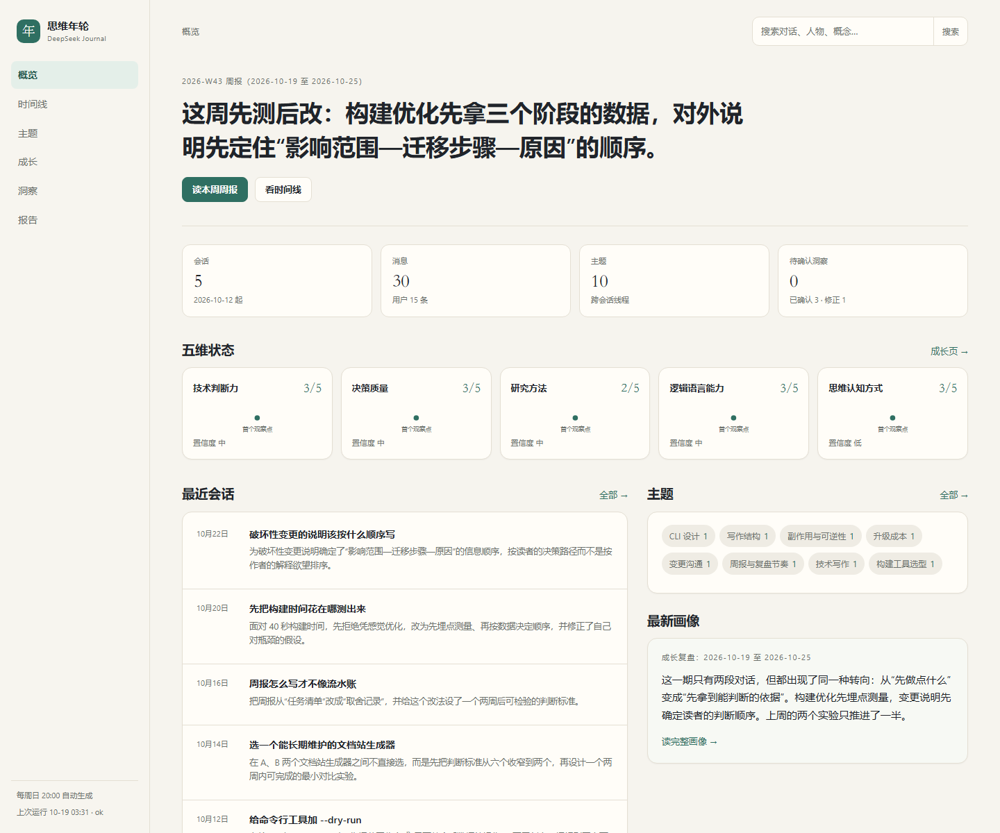
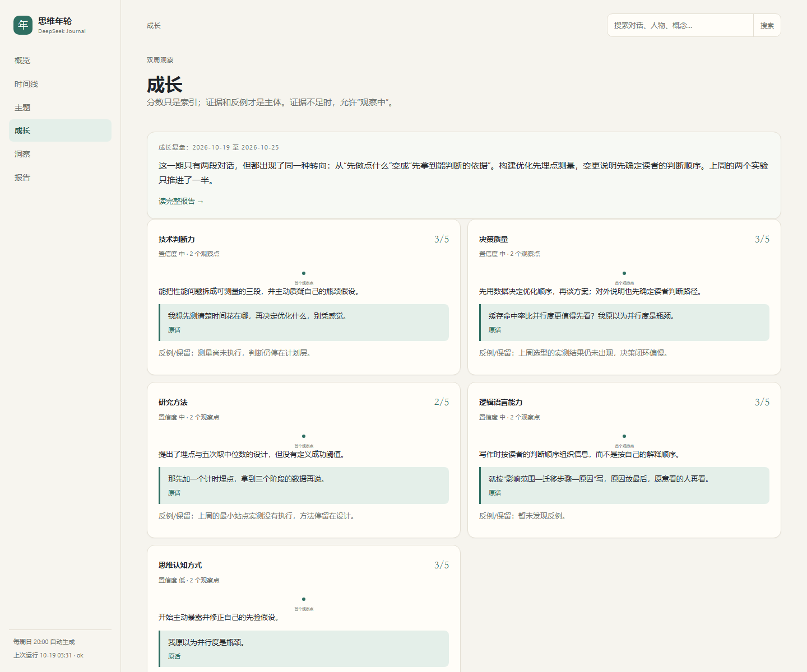
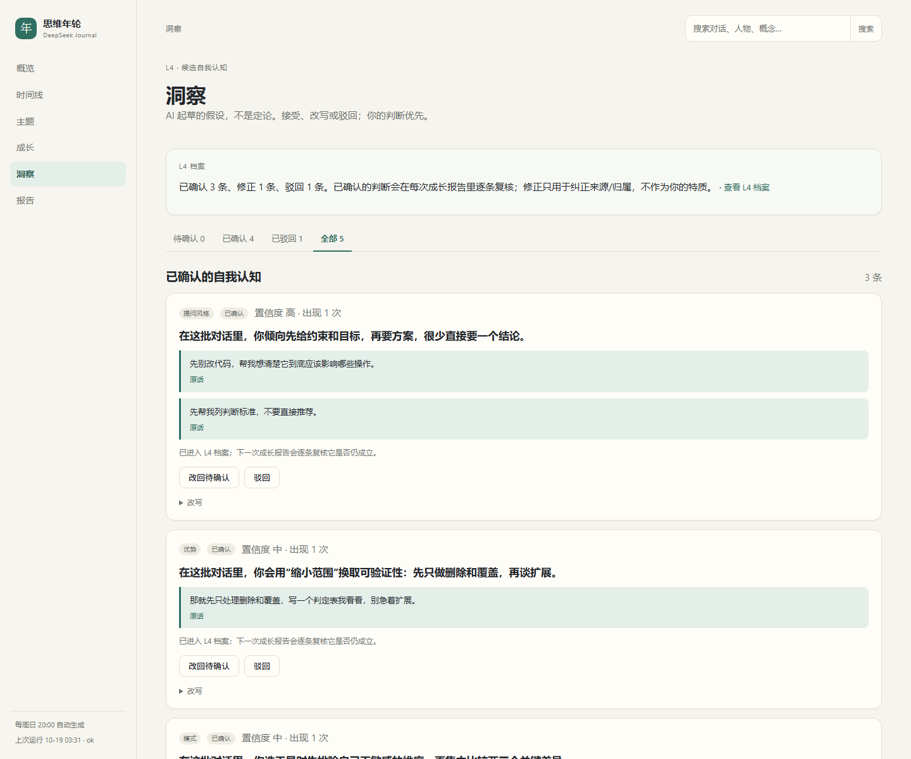
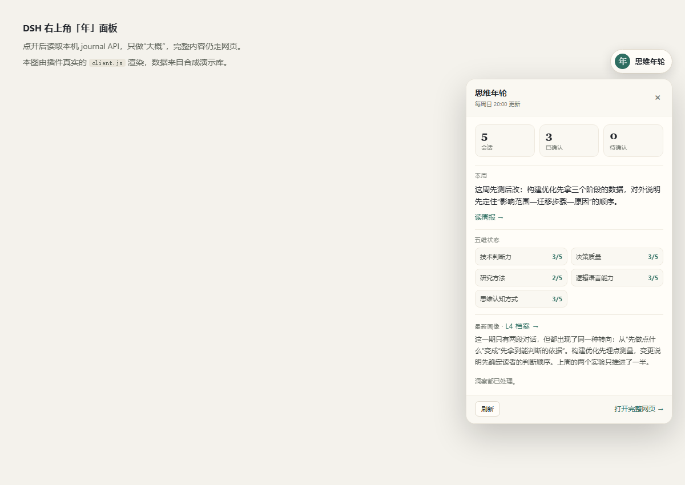

# 思维年轮 · DeepSeek Journal

把 DeepSeek Harness 的本地会话，变成一份能回看的“思维年轮”：按主题串线、每周周报、双周成长复盘，**每一条判断都能点回你当时说的那句原话**。

> **English summary** — DSH Journal turns your local DeepSeek Harness chat history into a reviewable journal: session cards, weekly digests, and a bi-weekly five-dimension growth review, where every claim must cite a verbatim quote from the original conversation. It runs entirely on your machine (Python 3.11+ standard library, plus Node for zstd decompression), calls only the DeepSeek API, and redacts secrets and local paths before anything leaves the process. Self-knowledge entries ("L4") are drafted by the model but **accepted or rejected by you** in the local web UI. MIT licensed, unofficial.



## 它解决什么问题

大多数“聊天总结”工具给你一段摘要，看完就没了。真正难的是：

- 三个月前你为什么会做那个决定？当时的问法和现在有什么不同？
- 哪些判断反复出现、哪些只是当时的情绪？
- 你说要做的实验，后来做了吗？

思维年轮把每个会话拆成**会话卡**（目标、关键转折、信号、自我描述、修正、承诺），再把卡片按周、按双周向上聚合，形成一条有时间纵深的证据链。它不评价你“优秀/差”，只记录可回链的行为。

## 三块界面

| 界面 | 用途 |
| --- | --- |
| 本地网页 `http://127.0.0.1:8765/` | 主界面：概览、时间线、主题、成长、洞察、报告、搜索、证据回链 |
| DSH `/journal` 技能 | 薄入口：一句话 + 五维状态 + 待确认洞察 + 网页链接 |
| DSH 右上角「年」面板 | 轻量：会话数与洞察数、本周一句话、五维状态、打开完整网页 |

### 双周成长复盘



五个维度：技术判断力、决策质量、研究方法、逻辑语言能力、思维认知方式。**分数只是索引**：证据不足就显示“观察中”，不硬打分；有反例就必须写 `counter_evidence`。满 3 个点（6 周）才谈“趋势”。

### 洞察（L4）：AI 起草，你确认



模型只能提出**候选**自我认知。你在网页上接受、改写或驳回；确认后进入 L4 档案，并会在下一次成长报告里被逐条复核（仍成立 / 减弱 / 出现反例 / 证据不足）。被驳回的判断不会原样重提。来源修正（例如“这句话其实是我朋友说的”）只用于纠正归属，不会被当成你的特质。

### DSH 面板



## 它是怎么工作的

```text
~/.dsh/sessions/**/session.v4.jsonl.zstd
        │  tools/decompress_session.mjs（多帧 zstd，Node）
        ▼
   JSONL 事件流 ──► 解析 / 过滤注入上下文 / 脱敏 ──► SQLite + FTS5
        │                                              │
        │                                    会话卡（LLM，引用逐条校验）
        │                                              │
        └──────────────► 周报 / 基线 / 双周成长 ◄───────┘
                                  │
                          L4 候选洞察 ──► 你在网页确认 ──► L4 档案
```

关键约束：

1. **证据优先**：引用必须在原消息里逐字找到，找不到就自动剔除，不会出现在报告里。
2. **区分谁在说话**：用户行才是关于你的证据；模型的话只用于理解上下文。
3. **注入内容不算你说的话**：DSH 会把 runtime-context、技能目录、时间等写入 user message，解析时按 `source.kind` 过滤。
4. **基线不打分**：第一次全量回看只建立起点，避免伪造成长曲线。

## 快速开始

### 依赖

- Python **3.11+**（`tomllib`、`sqlite3`、`zoneinfo`；无第三方包）
- Node **≥ 22.15**（解压多帧 zstd 用；DSH 自带的 Node 通常已满足）
- 一份 DeepSeek API key（只在你主动运行分析命令时才会用到）

### 运行

```bash
git clone <this-repo> dsh-journal
cd dsh-journal
cp config.example.toml config.toml      # 可选，默认值已够用
python -m journal.cli status            # 看能否找到 ~/.dsh/sessions
```

**不安装也能跑**：直接在仓库根目录执行 `python -m journal.cli ...`。`static/` 在仓库根目录，所以请从仓库根目录启动，不要只装包。

### 第一次全量回填

```bash
export DEEPSEEK_API_KEY=sk-...          # Windows: set DEEPSEEK_API_KEY=...
python -m journal.cli backfill --force
```

这一步会：同步历史会话 → 生成会话卡 → 生成基线画像 → 为已完成的历史周各生成一份周报。会产生 API 费用。想先看效果，可以只跑前两步的少量样本：

```bash
python -m journal.cli sync --limit 3
python -m journal.cli cards --limit 3
```

### 打开网页

```bash
python -m journal.cli serve --port 8765
```

然后访问 <http://127.0.0.1:8765/>。Windows 也可以双击 `start_web.cmd`（后台启动并打开浏览器）。

### 日常命令

```bash
python -m journal.cli status     # 数据概览
python -m journal.cli sync       # 只同步新会话
python -m journal.cli cards      # 为待处理会话生成卡片
python -m journal.cli weekly     # 跑一次周任务（周日 20:00）
python -m journal.cli growth     # 到期时生成双周成长报告
python -m journal.cli baseline   # 基线画像
python -m journal.cli l4         # 导出 L4 档案
```

### 定时任务

Windows：把 `run_weekly.cmd` 挂到任务计划程序，每周日 20:00。

```powershell
schtasks /Create /TN "DSH Journal Weekly" /SC WEEKLY /D SUN /ST 20:00 /TR "C:\path\to\dsh-journal\run_weekly.cmd" /F
```

任务默认是“仅交互式运行”，需要你处于登录状态；错过时间且当时已登录时会在可用时补跑。

macOS / Linux：一行 cron。

```cron
0 20 * * 0 cd /path/to/dsh-journal && ./journal.sh weekly >> "$JOURNAL_HOME/logs/weekly.log" 2>&1
```

> 成长报告不是每周都出：判定用 13 天而不是 14 天，避免“每两个周日”漂移到第三个周日。

## 装进 DSH

### `/journal` 技能

把 `skills/journal/` 复制到 DSH 的技能目录：

```bash
cp -r skills/journal ~/.dsh/skills/journal
```

之后在 DSH 里输入 `/journal`。

### 右上角面板插件

```bash
dsh plugin --profile desktop add ./plugin/dsh-journal-panel
```

装完要**完整重启** DSH（桌面端的注入表在启动时收集，热加载只补 API 不补按钮）。插件只读本机 `127.0.0.1:8765`，不写数据库。细节与回滚见 [plugin/dsh-journal-panel/README.md](plugin/dsh-journal-panel/README.md)。

## 配置

`config.toml`（从 `config.example.toml` 复制，已被 `.gitignore` 忽略）：

- `model.model`：默认 `deepseek-flash`
- `budget.max_total_tokens_per_run`：单次运行 token 上限（默认 300 万）
- `schedule.weekly_time`：默认 `20:00`
- `privacy.redact_paths`：入库前替换本机用户路径

也可以只用环境变量：

| 变量 | 作用 |
| --- | --- |
| `JOURNAL_HOME` | 数据/报告/日志根目录，默认 `~/DeepSeekJournal` |
| `DSH_HOME` | DSH 数据目录，默认 `~/.dsh` |
| `DSH_NODE` | 指定 `node` 可执行文件（找不到 Node 时） |
| `JOURNAL_TZ` | 计算周与日期用的时区，默认 `Asia/Shanghai` |
| `DEEPSEEK_API_KEY` | API key；也可放 `~/.dsh/.credentials.yaml` 或 `$JOURNAL_HOME/api_key.txt` |

## 隐私与数据边界

- Web 只绑定 `127.0.0.1`，没有登录，**不要暴露到局域网或公网**。
- 出网的只有发往 DeepSeek API 的请求。发送前会脱敏：`sk-` 类密钥、Bearer token、私钥块、邮箱、手机号、40 位以上 hex、长 base64、本机用户目录。
- 数据库、报告、日志、备份都在 `$JOURNAL_HOME` 下，**不属于仓库**，`.gitignore` 已排除。
- 报告里的引用是 `/sessions/...` 相对链接，只有在本地网页里才能打开。

更多说明见 [PRIVACY.md](PRIVACY.md)。

## 设计取舍

- **基线不打分**：第一份画像只建立起点。
- **双周取点**：周报每周，成长每两周；满 3 个点才标“趋势”。
- **分数是索引，不是结论**：`null` 表示证据不足，不等于 0 分。
- **L4 由用户确认**：AI 只起草候选。
- **修正 ≠ 特质**：来源修正只用于纠正归属。
- **本地优先**：默认只绑回环，凭据不写库、不写报告。

## 目录结构

```text
dsh-journal/
  journal/          # 引擎：解析、DB、脱敏、卡片、报告、Web、CLI
  static/           # 网页样式
  tools/            # zstd 解压、演示库生成、面板预览页
  skills/journal/   # DSH 技能
  plugin/           # DSH 浮动面板插件
  docs/             # 架构、五维 rubric、截图
  examples/         # 全合成的演示数据集
  tests/            # unittest
  config.example.toml
  pyproject.toml
```

## 开发与测试

```bash
python -m unittest discover -s tests -v
```

演示库（不需要 API key，也不读真实聊天）：

```bash
python tools/build_demo.py --home demo-home --clean
JOURNAL_HOME=demo-home python -m journal.cli serve --port 8766
```

`docs/screenshots/` 里的截图就是这样生成的：合成数据 + 真实前端 + 无头 Edge。

## 已知限制

- 只解析 DSH 的 `session.v4.jsonl.zstd` 会话格式；DSH 改格式时需要跟进。
- 报告质量取决于模型；引用校验能拦住“编造原话”，但拦不住“引用真实、解读过度”。所以 L4 必须由你确认。
- 首次全量回填的 token 消耗与历史长度成正比，建议先 `sync --limit 3` + `cards --limit 3` 试跑。
- 没有多用户、同步、移动端；它是一个本地单人工具。
- 面板插件依赖 DSH 内部注入点，属于非官方集成。

## 许可证与声明

MIT，见 [LICENSE](LICENSE)。本项目与 DeepSeek 官方无关；DSH 是 DeepSeek 的产品，本项目只是读取其本地数据的外部工具。
